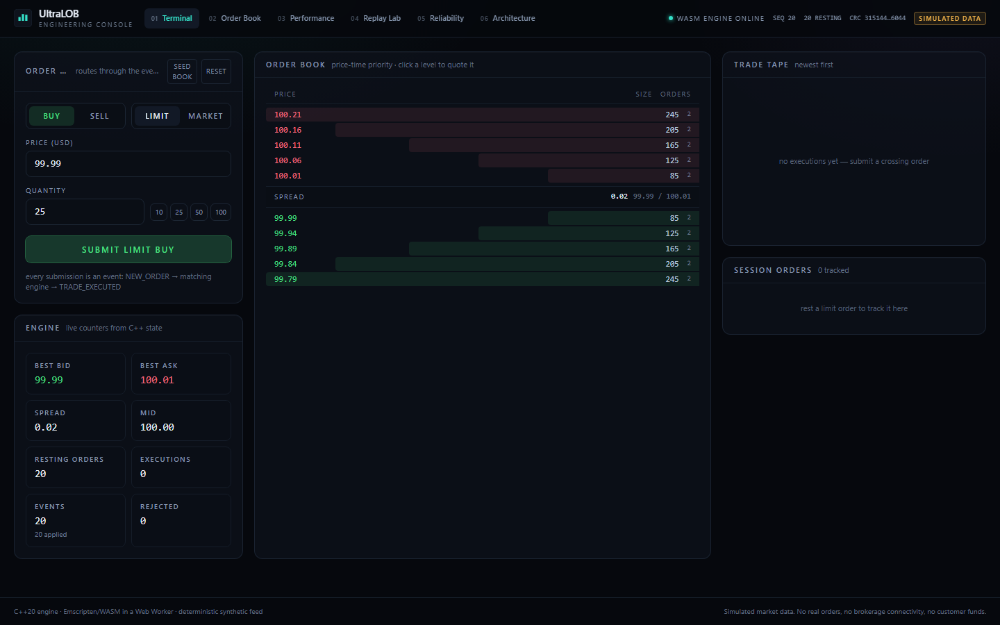
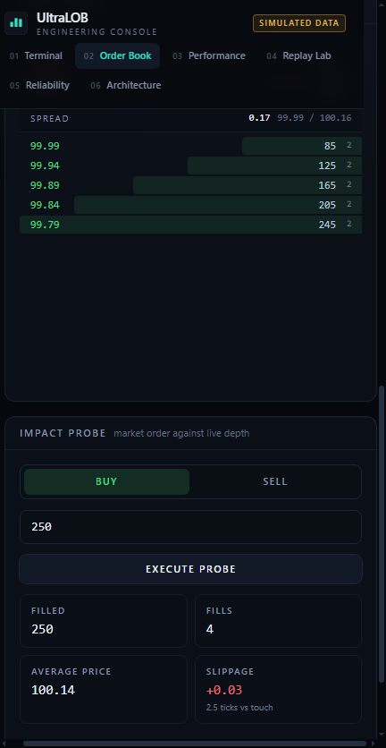
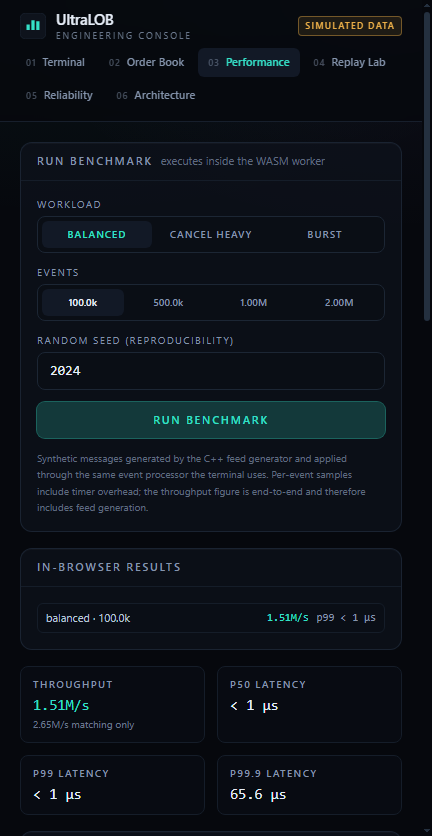
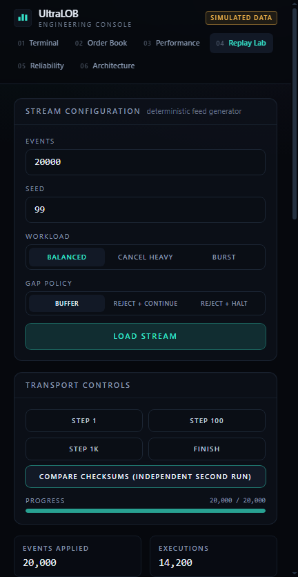
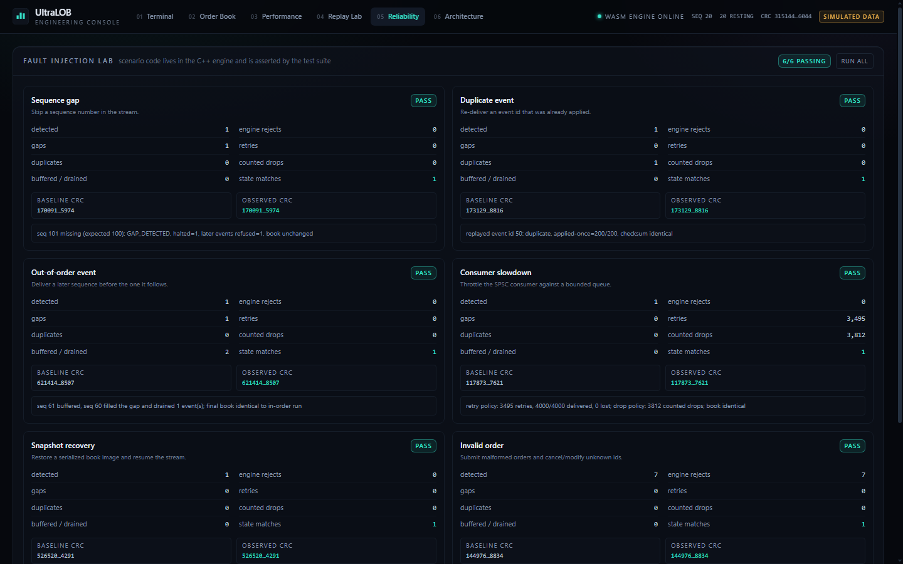
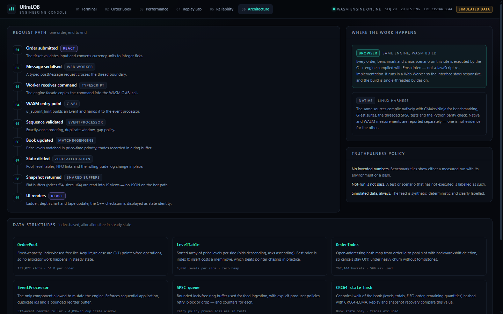
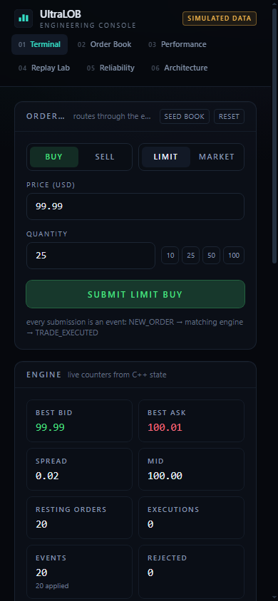

# UltraLOB

**A high-performance, event-driven limit order book and matching engine platform.**

C++20 engine · Emscripten/WebAssembly · React + TypeScript console · Python reference · Linux benchmarking.

UltraLOB is a simulated exchange core: a C++20 matching engine with price-time priority, a
sequence-aware event processor, deterministic replay, snapshot recovery, chaos scenarios and a
measured latency/throughput profile — all exposed through a browser console that runs the *actual*
engine compiled to WebAssembly.

> **Simulated market data only.** No real orders, no brokerage connectivity, no customer funds,
> no external market feed. The synthetic feed is deterministic and generated by the engine itself.

---

## What is here

| Area | What it does |
| --- | --- |
| **Matching engine** | Limit and market orders, cancel, modify, partial/full fills, price-time priority, integer-tick prices, O(1) cancels via an open-addressing id index |
| **Event processing** | Every mutation is an event with a sequence number; exactly-once application, duplicate-id window, gap policies (halt / resync / buffer), bounded reorder buffer |
| **Determinism** | Same stream in, same book out, verified with a CRC64 over canonical book state; a serialisable book image restores to the identical checksum |
| **Performance** | Zero heap allocation in steady state (proved by an instrumented test), fixed-capacity pool + sorted level arrays, SPSC ring buffer with explicit backpressure policies |
| **Browser console** | Six screens over the WASM build: terminal, order book, performance, replay lab, reliability lab, architecture |
| **Evidence** | GoogleTest suite, C++/Python parity check, chaos scenarios, native benchmark harness, generated reports in [`reports/`](reports/summary.md) |

## Measured results

From [`reports/summary.md`](reports/summary.md), produced by real runs on the machine that built
this repository (`scripts/run_benchmarks.sh`):

| workload | events | repeats | median throughput | p99 | p99.9 | heap allocations during run |
| --- | ---: | ---: | ---: | ---: | ---: | ---: |
| balanced | 1,000,000 | 3 | 3,898,008 msg/s | 521 ns | 1,028 ns | 0 |
| balanced | 10,000,000 | 1 | 3,889,979 msg/s | 533 ns | 1,037 ns | 0 |
| cancel heavy | 1,000,000 | 3 | 4,804,016 msg/s | 285 ns | 528 ns | 0 |
| burst | 1,000,000 | 3 | 4,782,964 msg/s | 282 ns | 525 ns | 0 |

Environment: AMD EPYC 7003 (Milan), **2 logical cores**, Ubuntu 24.04.5, GCC 13.3.0, `-O2`, shared
cloud runner with **no CPU pinning**. See [`docs/benchmarking.md`](docs/benchmarking.md) for what
these numbers do and do not mean. Per-event samples include clock-read overhead; the 10M-event run
shows a 16.7 ms maximum, which is scheduler preemption on a shared host, not engine work. Throughput
moves by ~25% between runs on this shared runner — compare ratios measured in one session, not
absolute values across sessions.

Correctness and reliability evidence in the same report:

- **59/59** GoogleTest cases across 12 suites (matching, book invariants, limits, determinism,
  snapshot restore, sequence gaps, backpressure, chaos, memory, pool, id index, WASM ABI).
- **6/6** fault-injection scenarios pass, each verified by book-state checksum equality.
- **C++/Python parity**: 5 checkpoints × 5 levels per side and 35,862 trades agree between the C++
  engine and an independent Python reference book over a 50,000-event stream.

### Baseline versus optimised (same process, same stream)

A second, deliberately simple engine (`benchmarks/baseline_engine.hpp`: `std::map` price levels,
`std::list` FIFO, `std::unordered_map` id index, heap allocation per resting order) mirrors the same
trading rules and the same canonical CRC64 walk, so equality is checked, not assumed. Both engines
consume one pre-generated event vector; correctness gates every timing.

| workload | UltraLOB | baseline | throughput | p99 UltraLOB | p99 baseline | allocations UltraLOB / baseline | peak RSS |
| --- | ---: | ---: | ---: | ---: | ---: | ---: | ---: |
| balanced | 4.70 M msg/s | 2.97 M msg/s | 1.58× | 516 ns | 2,049 ns | 0 / 1,013,860 | 71.1 / 116.1 MiB |
| burst | 4.71 M msg/s | 4.10 M msg/s | 1.15× | 513 ns | 521 ns | 0 / 881,876 | 71.1 / 113.0 MiB |
| cancel heavy | 5.01 M msg/s | 3.67 M msg/s | 1.37× | 286 ns | 537 ns | 0 / 1,034,732 | 71.1 / 114.4 MiB |

Full table, p99.9, max, state-equality verdicts and SVG charts:
[`reports/baseline_comparison.md`](reports/baseline_comparison.md). Reproduce with
`bash scripts/run_baseline_comparison.sh`.

## Architecture

```
React + TypeScript console (Vite, Tailwind, ECharts)
        │  typed postMessage RPC
        ▼
Web Worker ──► Emscripten C ABI ──► C++20 MatchingEngine (single-threaded WASM)
                                        │
engine/src/*.cpp ──► CMake + Ninja ──► native Linux binaries:
                                        GoogleTest suites, benchmark harness,
                                        CLI (replay/parity), chaos runner
```

The console never re-implements matching. Orders, benchmarks, replays and chaos runs all execute in
`engine/src/matching_engine.cpp` and friends, compiled twice: natively and to WebAssembly.

## Repository layout

```
engine/include/ultralob/   headers: order, price_level, level_table, order_index,
                          order_book, matching_engine, memory_pool, spsc_queue,
                          event, event_processor, replay, feed_generator,
                          snapshot, chaos, latency_histogram, crc64
engine/src/                 implementations
wasm/                       bindings.cpp (C ABI) + exports.json
web/                        React + TypeScript console, worker, WASM artefacts
tests/                      GoogleTest suites + parity_test.py
benchmarks/                 native harness, allocation tracker
tools/ultralob_cli.cpp      replay / verify / chaos CLI
scripts/                    benchmark + report + feed tooling
reports/                    generated, checked-in measurement artefacts
docs/                       architecture, design decisions, benchmarking, reliability
```

## Quickstart

### Native build, tests, benchmark (no CMake needed)

```bash
make test            # builds engine + GoogleTest suites, writes reports/gtest.xml
make bench           # native benchmark harness
make cli             # replay / verify / chaos CLI
bash scripts/run_benchmarks.sh   # full matrix + regenerate reports/
```

`make test` fetches GoogleTest 1.15.2 into `build/` on first run (it is not vendored).

### CMake (canonical build for CI / Codespaces)

```bash
cmake -S . -B build-cmake -G Ninja -DCMAKE_BUILD_TYPE=Release
cmake --build build-cmake
ctest --test-dir build-cmake --output-on-failure
```

### WebAssembly + console

```bash
# Emscripten is required for the WASM build (see docs/benchmarking.md)
source /path/to/emsdk/emsdk_env.sh
make wasm            # emits web/src/wasm/ultralob.mjs + web/public/wasm/ultralob.wasm

cd web
npm install
npm run dev          # http://localhost:3000
npm run build        # typecheck + production bundle
```

The checked-in `web/public/wasm/ultralob.wasm` is the real engine build (≈50 KB), so the console runs
without an Emscripten toolchain; `make wasm` regenerates it.

## Verification

```bash
make test                                   # 59 GoogleTest cases
python3 tests/parity_test.py --events 50000 # C++ vs Python reference book
./build/ultralob_cli verify --events 200000 --seed 7 --workload balanced
./build/ultralob_cli chaos                  # six reliability scenarios
bash scripts/run_benchmarks.sh              # measurements + reports/
```

## Engine rules (documented policies, not accidents)

- **Market orders never rest.** Unfilled remainder is cancelled (IOC).
- **A crossing limit order matches first**, then only the remainder rests.
- **Modify keeps queue priority only** when the price is unchanged and quantity does not increase;
  anything else re-enters at the tail and may trade.
- **Self-trade is allowed** — this is a simulator, not a regulated venue.
- **The checksum covers book state only** (levels, totals, FIFO order, remaining quantities). Trades
  are a consequence of state transitions; a book image does not serialise the trade tape.

## Limits and roadmap (not silently "done")

- Single-threaded WASM on purpose: multithreaded WASM needs `SharedArrayBuffer` and cross-origin
  isolation, which is out of scope for a $0 static deployment.
- Native benchmark runs here are on a **shared 2-vCPU runner**; no CPU affinity, no cache counters,
  no HdrHistogram dependency (a log-linear histogram is implemented in-tree instead).
- The baseline A/B engine is a single deliberately naive variant (`std::map` + `std::list` +
  `std::unordered_map`), not a family of variants; it exists to quantify the data-structure choice,
  not to be a competitive engine.
- Snapshot restore covers book state, not the rolling trade tape.
- No backend, database or accounts: each visitor gets an independent in-memory simulation.

## Documentation

- [`docs/architecture.md`](docs/architecture.md) — components, invariants, data flow
- [`docs/design-decisions.md`](docs/design-decisions.md) — trade-offs and rejected alternatives
- [`docs/benchmarking.md`](docs/benchmarking.md) — methodology, environment, honesty caveats
- [`docs/reliability.md`](docs/reliability.md) — policies, scenarios, recovery semantics
- [`docs/verification.md`](docs/verification.md) — browser matrix, API surface, deployment checks
- [`reports/final_verification.md`](reports/final_verification.md) — final PASS/FAIL/NOT VERIFIED report
- [`reports/summary.md`](reports/summary.md) — generated evidence tables
- [`reports/baseline_comparison.md`](reports/baseline_comparison.md) — A/B benchmark evidence

## Deployment

The console is a static bundle: no server, no database, no environment variables at runtime.
`web/dist` (≈1.4 MB, including the ≈56 KB `wasm/ultralob.wasm`) is the whole artefact.

### Cloudflare Pages

```bash
cd web && npm ci && npm run build          # tsc --noEmit && vite build → web/dist
npx wrangler pages deploy web/dist --project-name=ultralob
```

The same steps are automated in [`.github/workflows/deploy.yml`](.github/workflows/deploy.yml),
which rebuilds the engine with Emscripten first so the deployed WASM always matches the sources. It
needs two repository secrets — `CLOUDFLARE_API_TOKEN` (Pages: Edit) and `CLOUDFLARE_ACCOUNT_ID` — and
a Pages project named `ultralob`.

Any static host works (Netlify, S3 + CloudFront, nginx). Requirements:

- `application/wasm` for `*.wasm` (required: `WebAssembly.instantiateStreaming` is used by the glue).
- Routing is hash-based (`#/replay`), so a deep link refresh works without SPA rewrite rules.
- No COOP/COEP headers: the build is single-threaded on purpose.

### Release checklist

1. `cd web && npm ci && npm run build` — must print `tsc --noEmit` clean and `built in …`.
2. `make -j2 test` — 59/59 must pass; `bash scripts/run_baseline_comparison.sh` — `correctness: PASS`.
3. Cloudflare credentials live only in repository secrets (`CLOUDFLARE_API_TOKEN` with *Cloudflare
   Pages: Edit*, `CLOUDFLARE_ACCOUNT_ID`) or in the local environment for a manual `wrangler` run —
   never in the repository, the bundle or a commit.
4. Deploy, then open the public URL and re-run the six-page matrix in
   [`docs/verification.md`](docs/verification.md) against it (fresh profile, hard reload).
5. Only after that passes: `git tag -a v1.0.0 -m "UltraLOB 1.0.0" && git push origin v1.0.0 && gh release create v1.0.0 --notes-file reports/final_verification.md`.

`web/public/_headers` pins `application/wasm` for the WASM asset and long-lived caching for hashed
assets, so `WebAssembly.instantiateStreaming` always takes the streaming path.

### Hosting and cost

Static Cloudflare Pages only — no Functions, no Workers runtime, no database, no R2 bucket, no paid
add-ons. On the Pages **Free** plan a project like this one costs $0 with no time limit: static asset
requests and bandwidth are unmetered, the Free limits are 500 builds/month (1 concurrent, 20 min
timeout), 20,000 files per deployment, 25 MiB per file, 100 custom domains per project and 100
projects per account ([Cloudflare Pages limits](https://developers.cloudflare.com/pages/platform/limits/)).
UltraLOB uses 6 files totalling ≈1.4 MB and the largest file is 407 KB, so it is far inside every quota.
A `wrangler pages deploy` upload is not a CI build and does not consume the 500-build allowance.
No custom domain is required: the free `*.pages.dev` hostname is the public URL.

Deployment status is recorded in [`reports/final_verification.md`](reports/final_verification.md) and
[`docs/verification.md`](docs/verification.md); the public URL will be added here once Cloudflare
returns a deployment id and the deployed pages have been re-verified in a browser.

### Browser verification screenshots









## License

MIT — see [LICENSE](LICENSE).
