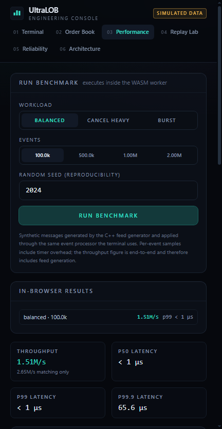

# UltraLOB — benchmarking methodology

## What is measured

`benchmarks/native_benchmark.cpp` drives the real engine with the real generator and reports, per
run:

| Metric | How it is obtained |
| --- | --- |
| Throughput | events / wall time for the whole loop (includes feed generation) |
| Matching-only throughput | events / sum of per-event timed regions (excludes generation) |
| p50 → p99.99, max, mean | log-linear latency histogram (`engine/include/ultralob/latency_histogram.hpp`) |
| Heap allocations, bytes | global `operator new/delete` override in `benchmarks/allocation_tracker.cpp`, reset immediately before the measured loop |
| Peak RSS | `getrusage(RUSAGE_SELF).ru_maxrss` |
| Trades, rejects, active orders, CRC64 | engine counters after the run |

Warm-up (2,000 events) runs before measurement and the engine is reset so warm-up allocations and
page faults do not land in the measured region.

## What is deliberately *not* claimed

- **No CPU pinning.** The reference runs happen on a shared cloud VM (2 logical cores). Frequency
  scaling, SMT neighbours and noisy neighbours are uncontrolled. `reports/benchmark_results.json`
  records `cpu_affinity: not pinned` and the repeat-to-repeat spread.
- **Per-event timers add overhead.** Each sample includes a `steady_clock` read before and after
  processing (tens of nanoseconds). The p50 is therefore an upper bound on engine work, and the
  matching-only throughput is closer to the engine's own rate.
- **No hardware performance counters.** L1 cache-miss counts would need `perf_event_open` and
  permissions that a shared runner does not grant; the report says so instead of inventing numbers.
- **No HdrHistogram dependency.** A fixed log-linear histogram with ~1% relative error per bucket is
  implemented in-tree so native, WASM and tests share one implementation. Percentile values are
  bucket representatives, not exact samples.
- **Outliers are real.** The 10M-event run shows a 16.7 ms maximum on a 2-vCPU shared host. That is
  scheduler preemption, not matching work; it is reported rather than trimmed.
- **WASM ≠ native.** The Performance screen measures the WASM build in the browser with its own
  clock. The two are shown side by side, labelled, never merged.

## Reproducing

```bash
make bench
./build/ultralob_bench --events 10000000 --seed 2024 --workload balanced --repeats 1 \
  --json-out /tmp/run.json
bash scripts/run_benchmarks.sh        # matrix + reports/ regeneration
```

Workloads (`engine/src/feed_generator.cpp`):

| Workload | Characteristics |
| --- | --- |
| `balanced` | mixed adds/cancels/modifies, 6% market orders, spread ±6 ticks |
| `cancel_heavy` | 55% cancels, 22% modifies, 3% market orders, tighter spread |
| `burst` | 14% market orders with large clips, 2-tick spread, faster mid drift |

All three are deterministic given a seed. The generator tracks only deep quotes for later
cancellation so the stream is not dominated by stale-cancel rejects; the residual reject rate
(balanced ≈ 5–6% of events) is still reported honestly by the harness.

## WebAssembly build

```bash
git clone --depth 1 https://github.com/emscripten-core/emsdk.git
cd emsdk && ./emsdk install latest && ./emsdk activate latest
source emsdk_env.sh
cd .. && make wasm
```

Flags of record (in the `Makefile` and `CMakeLists.txt`): `-O3 -std=c++20`, `MODULARIZE=1`,
`EXPORT_ES6=1`, `ENVIRONMENT=web,worker`, `ALLOW_MEMORY_GROWTH=0`, `INITIAL_MEMORY=128 MiB`,
`FILESYSTEM=0`, explicit `EXPORTED_FUNCTIONS` list, no pthreads.

Disabling memory growth is what lets the worker cache `HEAPU64`/`HEAPF64` views once; the engine's
fixed-capacity structures are sized to fit the static memory.

## Report pipeline

```
make test                → reports/gtest.xml
ultralob_bench ...       → reports/bench_raw_<workload>.json
ultralob_cli chaos       → reports/chaos_results.json
tests/parity_test.py     → reports/parity_results.json
scripts/generate_report.py → reports/{test,benchmark}_results.json, reports/summary.md
```

## Baseline versus optimised

`benchmarks/baseline_engine.hpp` is a deliberately naive second engine used to quantify the data
structure choice. It mirrors every trading rule (IOC market orders, crossing limits, modify
priority, self-trade allowed) and the exact canonical CRC64 walk, so state equality is *checked*
before any timing is reported.

| | UltraLOB | Baseline |
| --- | --- | --- |
| Price levels | sorted `std::array` per side | `std::map` per side |
| FIFO | pool indices with `prev`/`next` | `std::list` of heap `Order` objects |
| Id lookup | open-addressing index | `std::unordered_map` |
| Steady-state allocation | none | one per resting order |

Method (`scripts/run_baseline_comparison.sh` → `benchmarks/compare_benchmarks.cpp`):

- One `FeedGenerator` stream per (workload, seed, event count), generated once outside the timed
  loop and shared by both engines.
- 20,000-event warm-up on a throwaway instance, then a fresh engine for the measured loop.
- **One engine per process** (`--repeats 1` per invocation) so peak RSS belongs to a single
  implementation; the Python merger (`scripts/compare_report.py`) validates and formats.
- Correctness gate before timing: final CRC64, CRC64 at 25/50/100 % of the stream, trade count,
  reject count, active orders, depth, and a CRC64 over the last 200 trades.

Result (1,000,000 events, seed 2024, median of 3 processes per engine):

| workload | UltraLOB | baseline | ratio | p99 | p99.9 | allocations | peak RSS |
| --- | ---: | ---: | ---: | ---: | ---: | ---: | ---: |
| balanced | 4.70 M | 2.97 M | 1.58× | 516 / 2,049 ns | 537 / 4,098 ns | 0 / 1,013,860 | 71.1 / 116.1 MiB |
| burst | 4.71 M | 4.10 M | 1.15× | 513 / 521 ns | 530 / 2,074 ns | 0 / 881,876 | 71.1 / 113.0 MiB |
| cancel heavy | 5.01 M | 3.67 M | 1.37× | 286 / 537 ns | 532 / 2,077 ns | 0 / 1,034,732 | 71.1 / 114.4 MiB |

All three workloads report `state identical: PASS`. Charts: `reports/charts/*.svg`. Note that
`burst` is the workload where the naive structure suffers least (few resting orders, mostly market
orders), which is exactly what the data-structure argument predicts.

## Browser (WASM) measurements

Measured by the Performance screen inside the worker, with `performance.now()` — a different clock,
different allocator and no threads. These numbers are never combined with the native table.

| workload | events | throughput | p50 | p99 | p99.9 |
| --- | ---: | ---: | ---: | ---: | ---: |
| balanced | 100,000 | 1.51 M msg/s | `< 1 µs` | `< 1 µs` | 65.6 µs |
| balanced | 1,000,000 | 1.31 M msg/s | `< 1 µs` | `< 1 µs` | — |

Browser timers are clamped, so sub-microsecond percentiles are reported as `< 1 µs` instead of a
fabricated value. The 1 M run took 761 ms and produced 743,317 trades with
CRC64 15894895422671397000.



## Run-to-run variance

On the shared 2-vCPU runner, absolute throughput for the same workload varies by roughly 25% between
sessions (for example 3.90 M and 4.70 M msg/s for `balanced` in two runs on the same host). That is
the reason the A/B comparison is measured inside one session and reported as a ratio.
