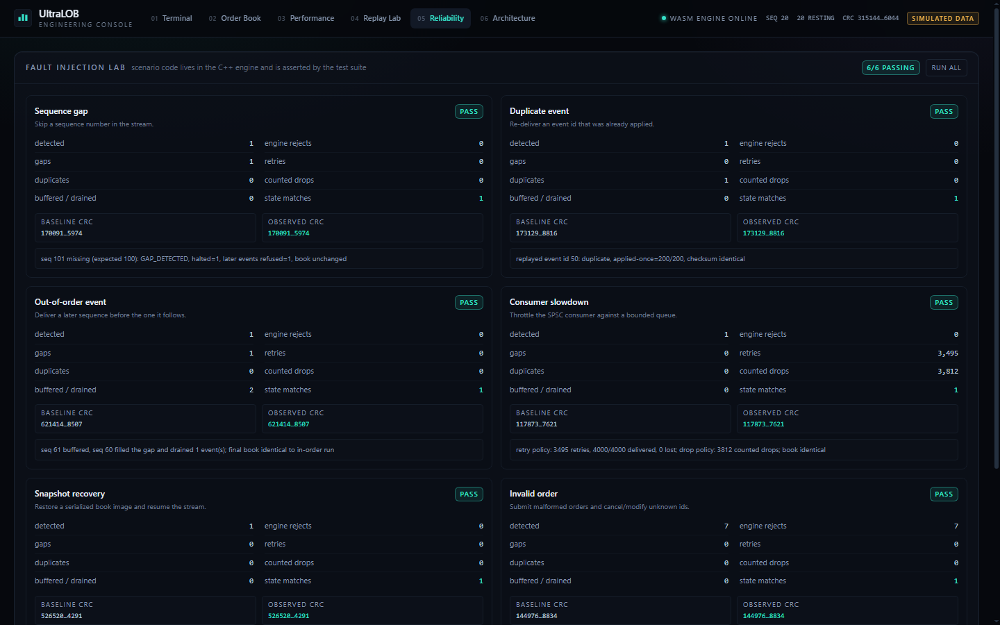

# UltraLOB — reliability and recovery semantics

## Sequence handling

Every event carries `seq` (stream position, 1-based) and `id` (dedupe key). `EventProcessor` applies
exactly one event per sequence number and reports every anomaly through `ProcessOutcome`.

| Situation | Status | What happens |
| --- | --- | --- |
| `seq == expected` | `Ok` / `Rejected` | applied; a business rejection still consumes the position |
| `seq > expected` | `Gap` | depends on policy (below) |
| `seq < expected`, id already seen | `Duplicate` | not applied |
| `seq < expected`, new id | `OutOfOrder` | not applied |
| processor halted | `Halted` | not applied |

Duplicate detection uses a direct-mapped window over the last 4,096 distinct event ids (single
probe). It is a bounded window by design — documented, not hidden.

### Gap policies

| Policy | Behaviour | Use |
| --- | --- | --- |
| `RejectAndHalt` | report the gap, stop applying events until recovery | strict audit mode |
| `RejectAndContinue` | report the gap, declare the missing range lost, resynchronise at the next sequence | best-effort ingestion |
| `Buffer` | hold later events in a 512-entry buffer and drain them in order once the gap is filled | default; demonstrated in the replay lab |

Buffer overflow is counted (`buffer_overflows`) and the offending event is reported as `Gap` — never
silently dropped.

## Fault-injection scenarios

Implemented once in `engine/src/chaos.cpp`, asserted by `tests/chaos_test.cpp`, surfaced by
`ultralob_cli chaos` and rendered in the console's Reliability screen.

| Scenario | Injection | Expected result |
| --- | --- | --- |
| `sequence_gap` | skip a sequence number | `GAP_DETECTED`, processor halts, later events refused, book unchanged |
| `duplicate_event` | re-deliver an applied event id | `Duplicate`, applied-once count unchanged, checksum unchanged |
| `out_of_order_event` | deliver seq N+1 before N | buffered, then drained in order; final book equals the in-order run |
| `consumer_slowdown` | throttle the queue consumer | retry policy loses nothing; drop policy drops exactly what it reports |
| `snapshot_recovery` | serialise book, restore, resume | restored checksum verified, resumed state equals uninterrupted run |
| `invalid_order` | bad quantity/price, unknown cancel/modify | every event rejected, book untouched, engine still usable |

Every scenario's verdict is **book-state checksum equality**, not a counter reading. A scenario that
merely "detected" something but corrupted state fails.

## Snapshot semantics

`engine/src/book_image.cpp` serialises:

```
BookImageHeader: version, order_count, seq, crc64, bids_depth, asks_depth,
                 bid_total, ask_total, trades
BookImageOrder × N (bids best→worst, then asks, FIFO inside each level):
                 id, price, remaining, seq, side
```

Restore inserts each record with `restore_resting_order` (no matching, no crossing) in that exact
order, then **recomputes the checksum and rejects the image if it differs from the header**.

Not serialised: the rolling trade tape. The trade counter is restored so snapshots compare equal,
but `recent_trades()` restarts from the checkpoint. This is a deliberate scope decision, stated in
the header comment and here.

## Backpressure

`SpscQueue<T, N>` is a bounded lock-free ring (acquire/release ordering, cache-line separated
indices). Producers choose a policy:

- `Retry` — spin (with `yield` natively) until space is available. Proven lossless in
  `tests/backpressure_test.cpp` with a deliberately throttled consumer and 100k events; the final
  checksum equals the unqueued baseline.
- `Drop` — record the event as dropped and count it. Test asserts `pushed + dropped == total` and
  `pushed == consumed`.
- `Block` — count blocked attempts (used with native ingest threads).

A bounded queue cannot guarantee unlimited producer progress. The project's position is that the
degradation must be declared, instrumented and observable — the chaos scenario reports retry counts
and counted drops side by side for exactly that reason.

## Reproducing the evidence

```bash
./build/ultralob_cli chaos                     # six scenarios, PASS/FAIL + detail
make test                                      # includes chaos assertions and gap tests
python3 tests/parity_test.py --events 50000    # independent reference book agrees
```

`reports/summary.md` is generated from those runs; nothing in it is hand-written.

## Verified run (native and browser)

Both `./build/ultralob_cli chaos` and the console's Reliability screen (same `engine/src/chaos.cpp`)
report 6/6 PASS. The counters observed in the browser on 2026-11-23:

| scenario | detected | gaps | duplicates | retries | counted drops | state matches |
| --- | ---: | ---: | ---: | ---: | ---: | :---: |
| sequence gap | 1 | 1 | 0 | 0 | 0 | yes |
| duplicate event | 1 | 0 | 1 | 0 | 0 | yes |
| out-of-order event | 1 | 1 | 0 | 0 | 0 | yes |
| consumer slowdown | 1 | 0 | 0 | 3,495 | 3,812 | yes |
| snapshot recovery | 1 | 0 | 0 | 0 | 0 | yes (171 orders, 6,912 bytes) |
| invalid order | 1 | 0 | 0 | 0 | 0 | yes (7 rejects) |

Scenario detail strings are generated in C++ and JSON-escaped at the boundary; CRC64 values are
emitted as strings because they exceed JavaScript's safe integer range.


