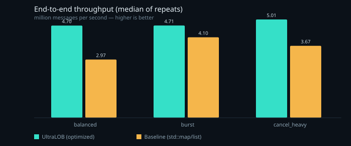
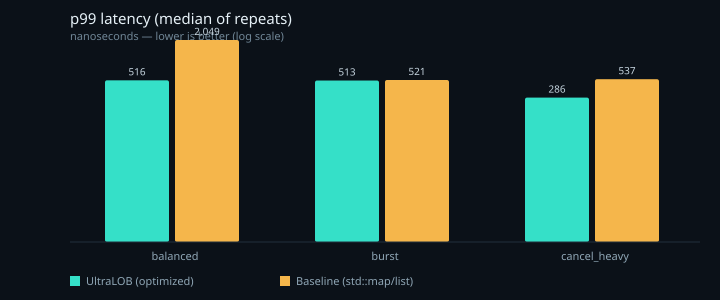
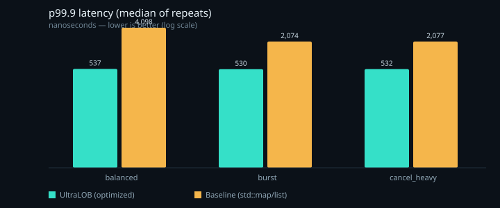
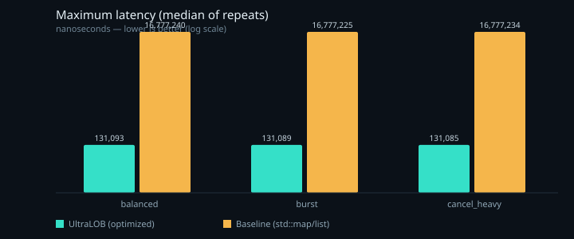
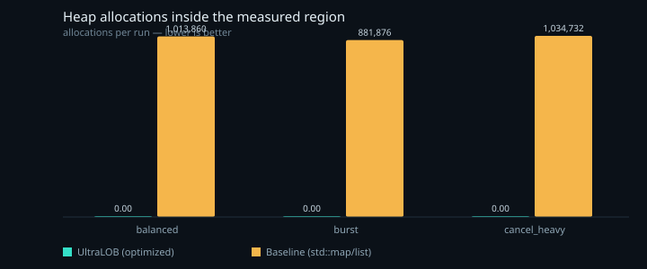
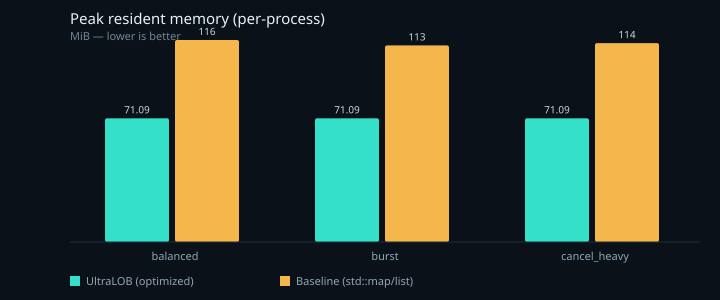

# Baseline vs optimized — measured comparison

Generated 2026-11-23T21:39:27Z by `scripts/run_baseline_comparison.sh`.

Both engines execute the same pre-generated event vector: identical seed, workload, order distribution and capacity limits. Correctness is checked before any timing is reported.

Environment: AMD EPYC 7003 (Milan) · 2 logical cores · Ubuntu 24.04.5 LTS · GCC 13.3.0 · shared runner, no CPU pinning, no hardware counters.

| workload | engine | msg/s | p50 | p99 | p99.9 | max | heap allocs | peak RSS |
| --- | --- | ---: | ---: | ---: | ---: | ---: | ---: | ---: |
| balanced | UltraLOB (optimized) | 4.70 M | 128 ns | 516 ns | 537 ns | 131,093 ns | 0 | 71.1 MiB |
| balanced | Baseline (std::map/list) | 2.97 M | 131 ns | 2,049 ns | 4,098 ns | 16,777,240 ns | 1,013,860 | 116.1 MiB |
| burst | UltraLOB (optimized) | 4.71 M | 128 ns | 513 ns | 530 ns | 131,089 ns | 0 | 71.1 MiB |
| burst | Baseline (std::map/list) | 4.10 M | 92 ns | 521 ns | 2,074 ns | 16,777,225 ns | 881,876 | 113.0 MiB |
| cancel_heavy | UltraLOB (optimized) | 5.01 M | 92 ns | 286 ns | 532 ns | 131,085 ns | 0 | 71.1 MiB |
| cancel_heavy | Baseline (std::map/list) | 3.67 M | 128 ns | 537 ns | 2,077 ns | 16,777,234 ns | 1,034,732 | 114.4 MiB |

| workload | throughput ratio | p99 ratio | allocations avoided | state identical |
| --- | ---: | ---: | ---: | :---: |
| balanced | 1.58× | 4.0× lower | 1,013,860 | PASS |
| burst | 1.15× | 1.0× lower | 881,876 | PASS |
| cancel_heavy | 1.37× | 1.9× lower | 1,034,732 | PASS |

## Charts

## Methodology

- Same `FeedGenerator` stream for both engines, generated once per process, outside the timed loop.
- 20,000-event warm-up on a throwaway instance, then a fresh engine for the measured loop.
- Each repeat runs in its own process, so peak RSS belongs to one implementation.
- Per-event timing uses `steady_clock` and the same log-linear histogram in both engines; samples include clock-read overhead.
- Heap allocations come from the global `operator new` override, reset immediately before the measured loop.
- Correctness gate: final book CRC64, CRC64 at 25/50/100% of the stream, trade count, reject count, active orders, depth, and a CRC64 over the last 200 trades.

Limitations: shared 2-vCPU runner without pinning; the baseline engine keeps a full trade vector while the optimized engine keeps a 65,536-entry ring, so the tail comparison covers only the most recent trades (the final state checksum covers the whole resting book).
